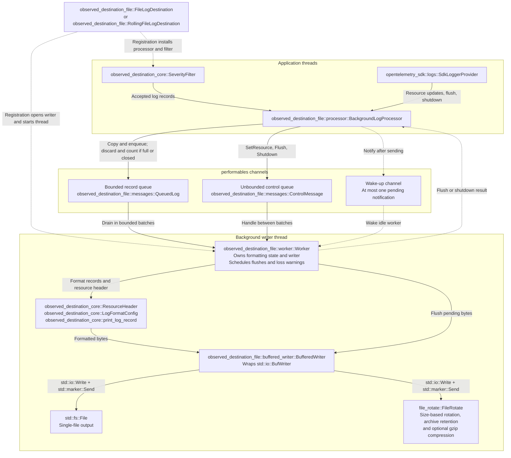

# File log destination design

`observed_destination_file` writes Observed logs to a single local file or
rotating files, with formatting and file writes on a background thread.
Application threads send accepted records through a queue with a fixed capacity.
One worker thread owns formatting, byte buffering, and output through a common writer
interface for both file types. A separate control channel carries resource
updates, flush requests, and shutdown requests.

## Construction and registration

`file_logs(path)` returns a builder for `FileLogDestination`.
`rolling_file_logs(path)` returns a builder for `RollingFileLogDestination` and
requires the `rolling_file` feature. Calling `.build()` creates a
`FileLogDestination` or `RollingFileLogDestination` struct in memory.
Creating and building a *destination* does
not open the file or start the worker thread.

For single-file output, [`FileWriterOpener::open_file`](../src/file_writer.rs)
registration opens `path` for writing. It creates the file if it is missing.
By default, it preserves existing contents and moves the write position to the
end. With `overwrite(true)`, it truncates the file to zero bytes.
An error from this opener returns as `FileLogInitError` before the background
writer thread starts.

For rolling output, `FileWriterOpener::open_rolling` calls
`file_rotate::FileRotate::new` with the path, size limit, retention limit, and
compression choice. This opener always returns `Ok` if the constructor returns.
In `file-rotate` 0.8.0, the constructor suppresses file-open errors and can panic
if directory creation fails. Registration can thus succeed without a usable
output file.

After the opener returns successfully, registration creates the channels,
starts one worker thread, and adds a `SeverityFilter` around
`BackgroundLogProcessor` to the provider builder.

## Threads and channel ownership

On application threads, `BackgroundLogProcessor::emit` adds `QueuedLog` records
to the shared record queue through `log_tx`. On the background writer thread,
`Worker` takes records from that queue through `log_rx` for formatting and file
output.

`BackgroundLogProcessor` shares `BackgroundWriterInner` through
`performables::arc::Arc`. Clones of `BackgroundLogProcessor` use the same `Worker`.
This state contains the channel senders, shutdown flag, lost-record counter,
and handle for the worker thread. `Worker` owns the channel receivers,
formatting state, and writer. During logging, `Worker` alone uses these
output objects.

Three `performables` channels connect `BackgroundLogProcessor` to `Worker`.
`BackgroundLogProcessor` holds their sending handles (`*_tx`), and
`Worker` holds their receiving handles (`*_rx`):

1. The record channel uses `log_tx` and `log_rx`. It holds `QueuedLog` values
   up to `queue_capacity`.
2. The control channel uses `control_tx` and `control_rx`. It carries
   `SetResource`, `Flush`, and `Shutdown` messages and has no fixed capacity.
3. The wake-up channel uses `wake_tx` and `wake_rx`. It holds at most one
   `()` notification.

## Record acceptance and loss reporting

[`SeverityFilter::emit`](../../observed_destination_core/src/filter.rs) compares
`data.severity_number().unwrap_or(Severity::Fatal)` with the configured minimum.
The filter applies the minimum log level, which defaults to `Info`.
The record keeps its original severity field.
The filter discards records whose comparison value is less than the minimum.
Setting the level to `Off` disables all records.
The filter calls `BackgroundLogProcessor::emit` only for accepted records.
Rejected records never enter `BackgroundLogProcessor`, so it does not copy or
queue them.

For each accepted record,
[`BackgroundLogProcessor::emit`](../src/processor.rs) copies the `SdkLogRecord`
and its `InstrumentationScope` into a `QueuedLog`. These copies let `Worker`
use the data after the application log call returns.

`queue_capacity` defaults to 4,096 records. This limits how many records wait for
`Worker`. Record sizes can differ, so this value alone cannot specify a memory
limit in bytes. A larger queue can absorb a longer period of slow output, but
also retains more data in memory.

`BackgroundLogProcessor` calls `log_tx.try_send(payload)` to add the copy to
the record queue.
If the queue is full or its receiver is closed, `BackgroundLogProcessor`
discards the new record and increases the lost-record counter. Existing queued
records remain available for `Worker` to process through `log_rx`.

After a successful send, `wake_worker()` calls `wake_tx.try_send(())` on a
separate wake-up channel. `()` is an empty value used as a wake-up notification.
The notification tells `Worker` to examine the record and control queues.
An idle `Worker` waits on `wake_rx`. Receiving this notification ends that wait.

The lost-record counter counts failed enqueue attempts. A failed enqueue does
not add a record to the record queue.
It does not include records lost through file errors.
`Worker` examines the lost-record counter at a one-minute interval and during
shutdown. It resets the count and writes a warning when the count is greater
than zero. The warning uses the same output writer as the records, so file
errors can also prevent the warning from appearing.

## `Worker` scheduling

[`Worker::run`](../src/worker.rs) owns the processing loop and final output.
Its `serve` loop handles control messages, writes a limited batch of records,
and examines the flush and loss-report deadlines. After each batch of log records,
the worker checks for control messages, even when more records are waiting.

The separate control channel lets provider requests enter even when the record
queue is full. After adding a record or control request, `BackgroundLogProcessor`
tries to send a notification through the wake-up channel. This gives `Worker`
one place to wait for either kind of work.

If the wake-up channel already holds a notification, `BackgroundLogProcessor`
ignores the failed attempt to add another. One pending notification is sufficient
because `Worker` examines both message queues when it resumes.
The records and control requests remain in their own queues until `Worker`
receives them.

When no record is ready, `Worker` calls `wake_rx.recv_timeout` to wait for a
notification or the next deadline. A notification or timeout returns `Worker`
to the loop that examines the control and record queues.
The wait includes the flush deadline only while formatted bytes remain in the
buffer. File writes and control handling use the same thread.
A blocked file operation delays record processing, provider requests, and
deadline handling.

## Formatting and byte buffering

`Worker` owns the `ResourceHeader`, `LogFormatConfig`, and `BufferedWriter`
described in this section. All record formatting and byte buffering happen inside
`Worker`, on the background writer thread.

`Worker` uses its `ResourceHeader` to write the current resource attributes
before its first record or loss warning. A `SetResource` control message replaces
the resource and enables a new header before the next record or warning.
`Worker` uses the current resource when it processes a queued record.

`Worker::write_log_result` calls `print_log_record` to convert each record to
text according to `LogFormatConfig`. The
[`BufferedWriter`](../src/buffered_writer.rs) owned by `Worker` collects the
resulting bytes in a `std::io::BufWriter` before sending them to the file writer.
This combines small writes and reduces the number of file operations.

`buffer_size` defaults to 256 KiB and controls the capacity for formatted bytes.
The record queue and this byte buffer serve different stages of the same path.
With `buffer_size` set to zero, formatted bytes go directly to the file writer.
The worker thread and record queue still operate.
The rolling destination limits the byte-buffer capacity to
`min(buffer_size, max_file_size)`.

Bytes pass to the file writer when the buffer lacks space or a large write
bypasses it. Automatic flushes, `force_flush`, and shutdown handle bytes that
remain buffered. `Worker` uses the same buffer for all these operations.

## File writers and rotation

Both destination types supply a writer that implements `Write + Send`.
`Write` supplies the output operations, and `Send` permits transfer to the worker
thread. This common interface lets both destinations use the same
`BackgroundLogProcessor` implementation, formatting, buffering, and error
handling.

For a single file, `FileWriterOpener` creates a `std::fs::File` and positions it
at the end of existing contents. `overwrite(true)` truncates the file during
registration. For rotating files, the opener creates a
`file_rotate::FileRotate`. That writer uses archive names with timestamps,
age or count retention, and optional gzip compression. Retention limits which
archives the writer keeps.

Rotation acts on bytes that the file writer receives. A write can take the
active file past `max_file_size` before rotation occurs. Thus, this value is a
rotation trigger, and files can exceed it.

## Flushing

A flush sends pending bytes through the file writer to the operating system.
`Worker` calls `BufferedWriter::flush` in three situations:

1. Automatic flushing: `Worker` periodically flushes pending formatted bytes
   using deadline checks in its thread loop and timed `wake_rx` waits when idle.
   This writes buffered output during normal operation, including periods when
   logging is idle.
2. Explicit flushing: `BackgroundLogProcessor::force_flush` requests a drain of
   queued records and a flush. The application uses this path when it needs a
   flush result before continuing, such as before reading the log file.
3. Shutdown flushing: `Worker` processes remaining queued records and flushes
   before it closes the writer. This handles the remaining output when the
   destination stops, as described in [Shutdown](#shutdown).

A successful flush makes output visible to the operating system.
Output can still be lost after a power failure. Records discarded before
the flush remain lost even when the flush succeeds.

### Automatic flushing

`flush_interval` controls automatic flushing and defaults to five seconds.
The interval must be nonzero. Registration rejects zero with `FileLogInitError`
before it opens the writer.
`Worker` maintains this deadline independently of incoming records, so continuous
logging cannot postpone it.
The timed wait also lets `Worker` flush after logging stops. The actual
flush time depends on thread scheduling and file operations.

An automatic flush writes only bytes already formatted in `Worker`'s buffer.
Queued records stay in the record queue for later processing. Incoming records can
still enter that queue, subject to `queue_capacity`. Incoming control messages
also remain queued until the flush finishes.

After each scheduled flush attempt or explicit `force_flush`, the worker
restarts the timer for automatic flushing.
Writing bytes because the buffer lacks space does not restart the automatic
flush timer. An automatic flush skips an empty buffer.
After a scheduled failure, `Worker` advances the deadline
to prevent continuous retries.

### Explicit flushing

`BackgroundLogProcessor::force_flush` sends a `Flush` control message and waits
for an acknowledgment from `Worker`. For this request, `Worker::flush_pending`
drains records until `log_rx.try_recv` finds the queue empty. It uses
`Worker::write_log_result` to format and write each record, as the bounded
batches in the scheduling loop do.

Records enqueued during the drain can join it and extend the caller's wait.
Records enqueued after the drain ends remain queued for later processing.
After the drain, `Worker` flushes its byte buffer and sends the result.

Incoming `SetResource`, `Flush`, and `Shutdown` messages remain queued while
`Worker` drains records and flushes output. Deadline checks also wait until this
operation finishes. After sending the result, `Worker` returns to the loop that
handles control messages and bounded record batches.

`flush_ack_timeout` limits the acknowledgment wait and defaults to one minute.
If the wait expires, `BackgroundLogProcessor` returns `InternalFailure`.
`BackgroundLogProcessor` also returns `InternalFailure` if `Worker` is
unavailable.

A timeout ends the caller's wait for an acknowledgment. It does not remove a
queued `Flush` message or interrupt a flush already in progress. `Worker` can
still finish that flush after `BackgroundLogProcessor::force_flush` returns.

## Write and flush errors

The log call returns without waiting for file output, so it cannot return output
errors to the application. `Worker` saves the first write or automatic flush
error for the next `force_flush` or shutdown (sync operations where the error
can be communicated to the caller).
`BackgroundLogProcessor` reports these errors to the caller only through an
explicit flush or shutdown result.

`Worker` can also encounter errors while draining records and flushing the
writer in response to a `Flush` or `Shutdown` control message.
`Worker::flush_pending` takes and clears the saved error before draining records.
It returns the first saved or newly observed error in the operation result.
If the acknowledgment arrives before the timeout, `BackgroundLogProcessor`
reports the error as `InternalFailure`.

If a `force_flush` caller times out, `Worker` can still process the flush and
clear the saved error. The acknowledgment then fails, and `Worker` discards its
result. The write error can thus remain unreported, and later flush or shutdown
calls do not report it again.

A write can fail after part of its input is already in the file.
`BufferedWriter` discards the remaining buffered bytes after a write error.
This prevents a retry from writing the same bytes twice.
The file can contain incomplete records, and unwritten output can be lost.
After a write error, `Worker` continues to process later records and attempts
to write them to the file.

A failure in the underlying writer's `flush` can occur after all buffered bytes
were written. That failure also becomes a reported error.
The buffer is already empty, so a later flush does not send those bytes again.

## Shutdown

`BackgroundLogProcessor::shutdown_with_timeout` sets the shutdown flag before
it sends `Shutdown`. Later calls to `BackgroundLogProcessor::emit` that see the
flag ignore new records.

When `Worker` receives the request, it leaves the processing loop.
Control messages still in the control queue remain unprocessed.
`Worker` reports remaining queue losses, processes queued records, flushes the
writer, and closes it. `Worker` sends its acknowledgment only after it
closes the writer. The caller then joins the thread, which waits for the thread
to finish. This shutdown succeeds only after `Worker` closes the file
and the background writer thread exits.

Calls already past the shutdown check can still add records. `Worker` includes
those records if it receives them during the final drain. A record added after
that drain ends can remain unwritten.

If the acknowledgment wait expires, `BackgroundLogProcessor` returns `Timeout`
without joining the worker thread. `Worker` can continue its pending
operations and keep the file open while an operation is blocked.
The timeout does not cancel file operations.

`BackgroundLogProcessor` keeps its shutdown flag set after success, timeout, or
failure.
It treats later shutdown and `force_flush` calls as successful requests without
doing work. The first call's result records whether shutdown completed, failed,
or timed out.
