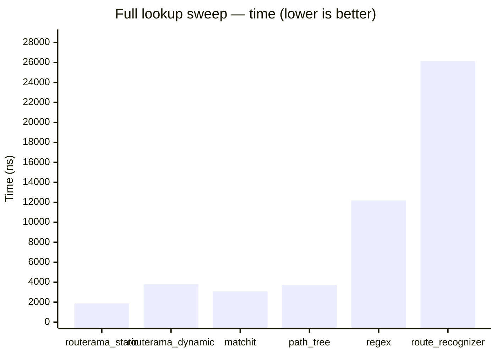
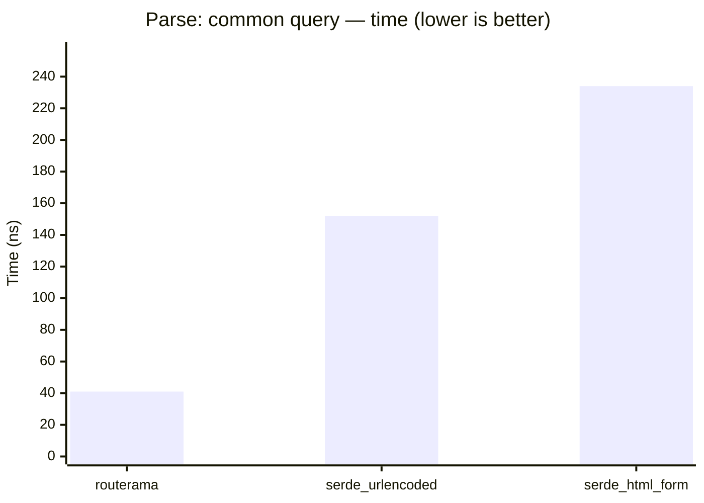
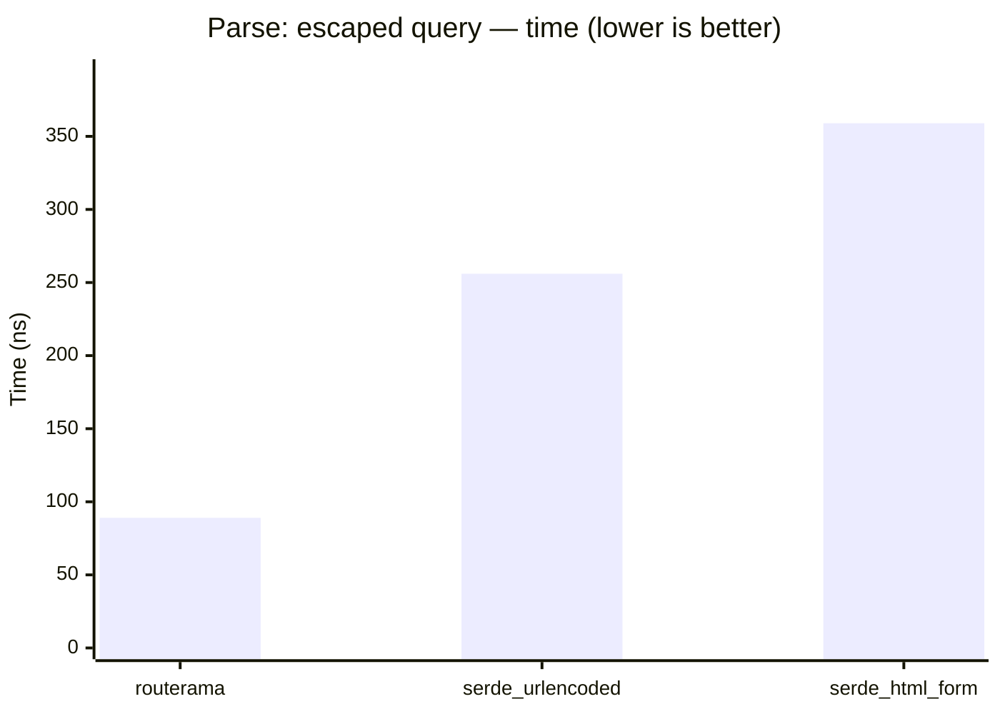
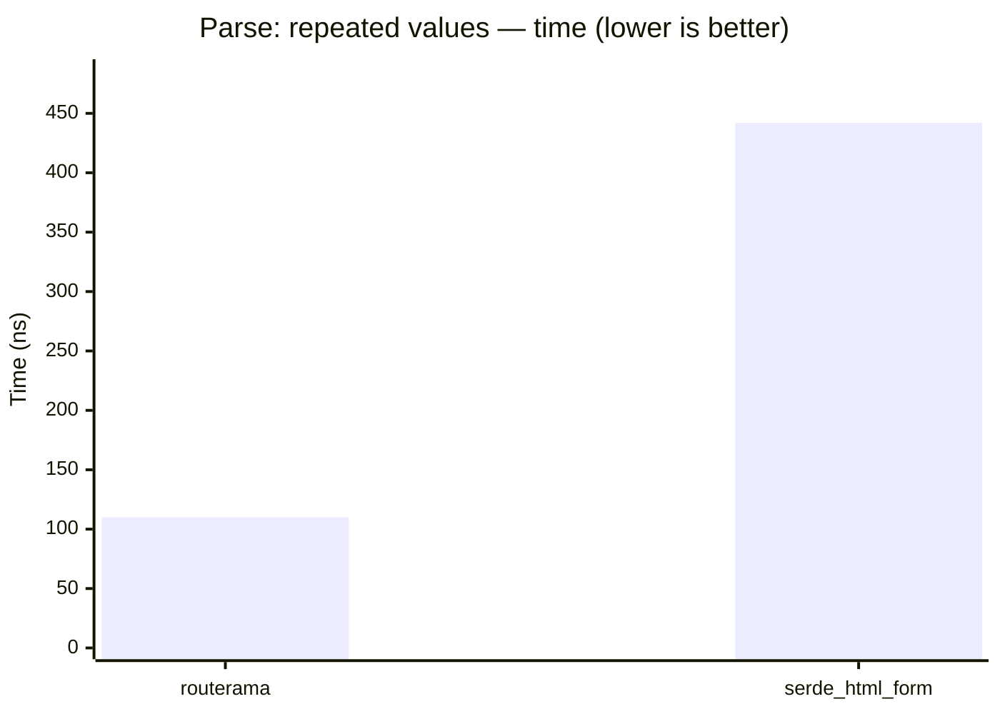
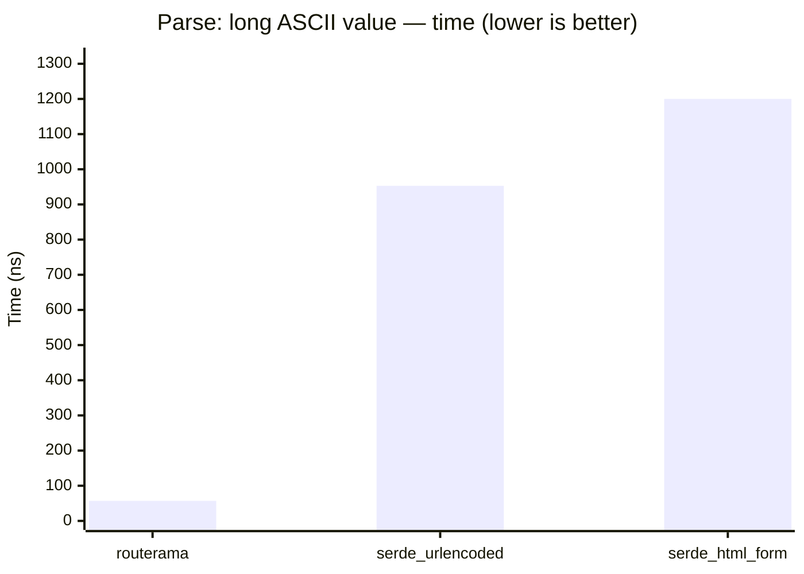
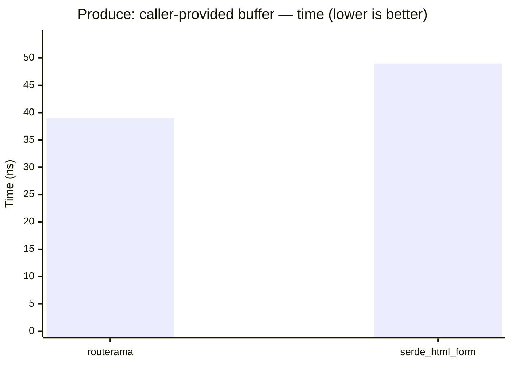
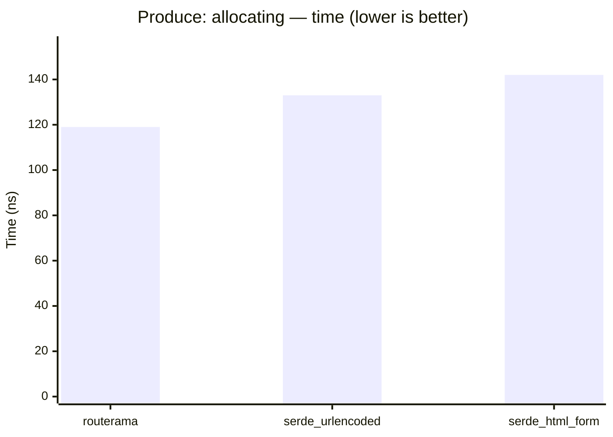

# Routerama Performance Report

How Routerama compares to the frameworks and routers you would otherwise pick, on
workloads you can recognize. Every table here is differential: it names the
alternative it is measured against, and reports wall-clock time.

Instruction counts, acceptance-gate evaluations, audit boundaries, and
generated-code size are engineering records rather than comparative claims, and
live in [`PERF-INTERNAL.md`](PERF-INTERNAL.md). See
[`benches/README.md`](../benches/README.md) for the three benchmark families and
the audience each serves.

The tables and charts between `<!-- BEGIN GENERATED -->` and
`<!-- END GENERATED -->` markers are rebuilt by `scripts/perf_report.rs` from:
- `cargo bench --features resolve --bench criterion_routers` — criterion wall-clock timings.
- `cargo bench --features query --bench routerama_query` — differential query-codec timings.

Everything outside those markers is hand-written and survives regeneration.

Dated measurement sections state the toolchain and exact commands of the run
that produced them. Results are never re-run in place: an older table keeps its
original figures and its original label, and a newer measurement is added as its
own dated section.

Raw benchmark output is not checked in. Each section quotes the exact commands
that produce it, so a run can be reproduced on any host; only compare numbers
that were captured on the same host, toolchain, and date.

**Workload:** one full sweep of the shared request-path lookups (see `benches/common/routes_data.rs`) against each router. Every router is built from the same route table (literal segments plus single-segment `{var}` parameters — the common subset all of them express) in a setup step that is excluded from the measured region. Setup also performs one full unmeasured lookup sweep to initialize lazy matcher and allocator state before measuring the steady-state hot path; `routerama_static` is the compile-time `#[resolver]` router, so it has no construction cost, while `routerama_dynamic` is the run-time router registered from the same table.

**Apples-to-apples:** every router is driven to the same *typed* end state — the HTTP method (verb) validated against the request and every captured path variable coerced into its declared type (`u32` parsed, `String` percent-decoded and owned, `&str` borrowed). `routerama` reaches this in one step (a typed enum variant with the method already matched and every field coerced); the third-party routers only *select* a route, so the harness explicitly checks the method and coerces each parameter the same way afterwards. `regex` selects the winner with a `RegexSet` and then re-scans it with the winning `Regex` to capture (two passes), so it does structurally more work — read it as an upper bound for a regex-based router reaching the same end state.  
Criterion median is reported (default 30 samples, 1 s warm-up, 2 s measurement; override with `--samples` / `--measurement-time` / `--warm-up-time`).

## `compare_routers`

<!-- BEGIN GENERATED: resolver-comparison -->



| Resolver | Time (criterion) | Time vs Routerama |
|---|---:|---:|
| `routerama_static` | 1.88 µs | 1.00× |
| `routerama_dynamic` | 3.80 µs | 2.02× |
| `matchit` | 3.09 µs | 1.64× |
| `path_tree` | 3.72 µs | 1.98× |
| `regex` | 12.19 µs | 6.48× |
| `route_recognizer` | 26.13 µs | 13.90× |
<!-- END GENERATED: resolver-comparison -->

**2026-07-27, effect of the sibling-literal lookup change.** The table above is
not re-run in place. The change described under "Mount-table size no longer
depends on registration position" touches the run-time resolver this workload
measures, so the workload was measured across it, on one host and toolchain,
with `cargo bench -p routerama --features resolve --bench gungraun_routers` run
once with the matcher as it stood before the change and once after. This route
table's widest node holds fewer than sixteen sibling literals, so every lookup
takes the unchanged scan and the only cost is the per-node fanout test:
`routerama_dynamic` 26,737 → 26,862 instructions (+0.5%), its miss sweep
3,044 → 3,072 (+0.9%), and `routerama_static` 15,284 → 15,284 — byte-identical,
because generated dispatch is not involved. Those two runs are comparable with
each other and not with the older figures in the table above.

## HTTP routing and dispatch

The five-way HTTP fixture measures complete in-process routing, extraction,
handler invocation, response conversion, and body observation with no network
I/O. Every framework has the same 16 routes in the same order and produces the
same checked status, headers, and body. Runtime and application construction,
request creation, warmup, and teardown are outside the measured region.

These results were captured on 2026-07-25 with:

```text
cargo bench -p routerama --features query,route \
    --bench routerama_http_dispatch -- \
    --warm-up-time 1 --measurement-time 2 --sample-size 30 --noplot
cargo bench -p routerama --features query,route \
    --bench routerama_http_dispatch_cg
```

Time is Criterion's median point estimate in nanoseconds. Lower is better.
The matching instruction counts are in [`PERF-INTERNAL.md`](PERF-INTERNAL.md).

| Scenario | Routerama ns | Axum ns | Actix Web ns | Rocket ns | Warp ns |
|---|---:|---:|---:|---:|---:|
| Literal first | 362 | 746 | 673 | 2,325 | 1,258 |
| Literal middle | 366 | 743 | 1,103 | 2,498 | 1,827 |
| Literal last | 371 | 719 | 1,094 | 2,567 | 2,048 |
| Captures | 393 | 1,157 | 2,153 | 2,783 | 1,968 |
| Method/header/query | 1,088 | 1,686 | 1,484 | 3,062 | 2,113 |
| Status/header response | 421 | 883 | 1,083 | 2,209 | 1,638 |
| Complete miss | 247 | 760 | 964 | 2,433 | 2,088 |
| Capture failure | 254 | 1,206 | 2,952 | 2,825 | 1,506 |

Across these eight scenarios, Routerama's geometric-mean median is 392 ns
versus 944 ns for Axum, the fastest comparison framework. Its geometric-mean
instruction count is 2,727 versus Axum's 5,676. That is 58% less time and 52%
fewer instructions, and Routerama is the lowest result in every measured row.

**Corrected typed-capture rerun (2026-07-27).** Axum, Actix Web, and Warp now
use native typed numeric capture extraction rather than allocating `String`
values and parsing in handlers. On the final tree, Routerama's eight-row
instruction geometric mean is 2,806 versus Axum's 5,672 (50.5% fewer), and
Routerama remains the lowest instruction result in every row. The exact command
is the Callgrind command above; the raw run also captures each per-row count.

An allocation sweep over one pre-created call for every scenario reports
5,007 bytes for Routerama, 10,554 for Axum, 4,048 for Actix Web, 17,385 for
Rocket, and 16,115 for Warp. This measures complete response production and
observation, not allocations only through handler entry, so it is diagnostic
and does not establish the zero-allocation entry gate.

These numbers establish the narrow 16-route, empty-request-body fixture only.
They do not cover 128/1,024-route scaling, bounded or streaming bodies,
middleware, transport I/O, throughput, or alternative Routerama response-body
representations.

### Route-set scaling

A generated fixture compares identical 16-, 128-, and 1,024-route literal
tables. Each size measures first, middle, last, and miss requests through the
same complete response-observation boundary as the capability fixture.

```text
cargo bench -p routerama --features query,route \
    --bench routerama_http_dispatch_scaling -- \
    --warm-up-time 1 --measurement-time 2 --sample-size 30 --noplot
cargo bench -p routerama --features query,route \
    --bench routerama_http_dispatch_scaling_cg
```

| Routes/scenario | Routerama ns | Axum ns | Actix Web ns | Rocket ns | Warp ns |
|---|---:|---:|---:|---:|---:|
| 16/first | 377 | 744 | 663 | 2,226 | 797 |
| 16/middle | 381 | 755 | 809 | 2,476 | 1,636 |
| 16/last | 381 | 747 | 923 | 2,723 | 2,262 |
| 16/miss | 226 | 632 | 636 | 2,324 | 1,874 |
| 128/first | 398 | 746 | 674 | 2,285 | 938 |
| 128/middle | 398 | 756 | 1,805 | 3,944 | 7,410 |
| 128/last | 395 | 757 | 2,848 | 5,766 | 13,793 |
| 128/miss | 234 | 626 | 2,139 | 4,811 | 12,821 |
| 1,024/first | 480 | 815 | 669 | 2,310 | 1,124 |
| 1,024/middle | 479 | 760 | 9,569 | 17,928 | 53,097 |
| 1,024/last | 481 | 762 | 20,429 | 39,969 | 109,334 |
| 1,024/miss | 306 | 666 | 14,772 | 32,093 | 101,537 |

At 1,024 routes, Routerama's four-scenario geometric mean is 429 ns and
2,685 instructions. Axum is the fastest comparison framework at 749 ns and
5,137 instructions, so Routerama uses 43% less time and 48% fewer
instructions. Across all 12 scaling scenarios, Routerama's geometric means are
368 ns and 2,564 instructions, versus Axum's 728 ns and 5,130 instructions.

Routerama's geometric-mean time increases 29% from 16 to 1,024 routes and its
instruction count increases 9%. Axum's corresponding costs are nearly flat.
This indicates generated-code or cache pressure worth tracking, but the
measured growth does not erase Routerama's lead at this scale.

The checked-in generated source was 540,156 bytes and contains per-route source
for Routerama and Rocket plus shared route tables for all three sizes; Axum,
Actix Web, and Warp construct routes from those tables at run time. After
`cargo clean -p routerama`, building the
combined release Criterion binary took 85.3 seconds with 1,287,312 KiB peak
resident memory on this machine; the resulting debuginfo-enabled binary was
56,960,800 bytes. These are combined-fixture engineering costs, not
per-framework application sizes, and should not be used to rank frameworks.

The 2026-07-27 audit measured the current generated file at 540,624 bytes and
the current combined binary at 57,045,144 bytes. Symbol attribution found
approximately 406,913 bytes of generated Routerama fixture `.text`; the
16/128/1,024-route services accounted for 2,234/45,704/358,975 bytes
respectively. This reveals a code-size step between 16 and 128 routes that the
latency table does not show. These symbol totals exclude inlined code and remain
engineering diagnostics, not cross-framework application-size comparisons.

### Bounded body extraction

The body fixture compares complete in-process routing, explicitly limited body
consumption, handler invocation, response conversion, and response-body
observation. Every extractor has a 64-byte encoded-body limit. The scenarios
cover one- and two-frame bytes, exact-limit acceptance, UTF-8 text, JSON,
per-extractor overflow, invalid UTF-8, malformed JSON, and missing or
unsupported JSON media types.

Limit enforcement follows each framework's idiomatic boundary. Routerama,
Axum, and Actix Web use their bounded extractors; Rocket uses its configured
data limit. Warp combines `content_length_limit(64)` with a transport
`Limited` body, and adds an explicit Content-Type-presence filter because its
JSON filter accepts a missing header. Warp's encoded-overflow rows can
therefore reject from `Content-Length` before polling; they are not evidence
about byte-driven overflow behavior.

```text
cargo bench -p routerama --features json \
    --bench routerama_body_extraction -- \
    --warm-up-time 1 --measurement-time 2 --sample-size 30 --noplot
cargo bench -p routerama --features json \
    --bench routerama_body_extraction_cg
```

| Scenario | Routerama ns | Axum ns | Actix Web ns | Rocket ns | Warp ns |
|---|---:|---:|---:|---:|---:|
| Bytes, one frame | 488 | 1,290 | 1,108 | 3,547 | 878 |
| Bytes, two frames | 528 | 1,312 | 1,061 | 3,514 | 956 |
| Bytes, exactly 64 | 563 | 1,358 | 1,229 | 3,583 | 942 |
| UTF-8 text | 538 | 1,293 | 1,373 | 3,503 | 1,032 |
| JSON | 893 | 1,788 | 1,488 | 3,749 | 1,551 |
| Bytes, 65 rejected | 326 | 953 | 915 | 5,601 | 706 |
| UTF-8 text, 65 rejected | 328 | 1,006 | 1,149 | 3,171 | 706 |
| JSON, encoded 65 rejected | 439 | 1,125 | 1,004 | 3,032 | 809 |
| Invalid UTF-8 | 402 | 1,054 | 1,227 | 3,301 | 727 |
| Malformed JSON | 614 | 1,538 | 1,199 | 3,397 | 1,195 |
| Unsupported JSON media type | 482 | 1,103 | 1,008 | 2,847 | 997 |
| Missing JSON media type | 424 | 1,170 | 794 | 2,278 | 735 |

Routerama's 12-scenario geometric means are 484 ns and 3,201 instructions.
The fastest comparison geometric means are Warp at 911 ns and Actix Web at
5,773 instructions. Routerama therefore uses 47% less time and 45% fewer
instructions, and has the lowest result in every row.

**Corrected collector and fixture rerun (2026-07-27).** Single-frame bodies
now retain their original `Bytes`; multi-frame bodies reserve once from the
bounded size hint. Warp's invalid-UTF-8 path now validates before allocating.
With the same Callgrind command, Routerama's 12-row instruction geometric mean
is 2,984 versus Actix Web's 5,773 (48% fewer), and Routerama remains lowest in
every row. Complete-sweep allocation bytes are 3,429 for Routerama versus
31,659/89,214/86,993/10,111 for Axum/Actix Web/Rocket/Warp. Exact regression
tests additionally prove zero payload allocation for one frame and one
exact-sized allocation for sixteen frames. Criterion remains host-sensitive;
the corrected text-success median was 732 ns versus Warp's 1,023 ns in this
run.

The complete 12-call allocation sweeps report 4,292 bytes for Routerama,
31,659 for Axum, 89,214 for Actix Web, 86,993 for Rocket, and 10,117 for Warp.
These spans include extraction, application responses, framework adapters,
and body observation; they are not measurements only through handler entry.

Routerama, Axum, Actix Web, and Warp receive a genuine two-frame body in the
split scenario. Rocket's local client coalesces the supplied bytes, so its
entry is explicitly named `rocket_coalesced_client_body` in benchmark output
and must not be interpreted as multi-frame evidence.

### Bounded form extraction

The form fixture is the `application/x-www-form-urlencoded` counterpart of the
body fixture. Every framework decodes the same three-field schema (`name:
String`, `count: u32`, `note: Option<String>`) from the same encoded bytes,
under the same 64-byte encoded-body limit, requiring the same media type, and
producing the same `name:count:note` response body with the same marker header.
Routerama uses its own `route::form::Form<T, 64>` over the `FromQuery` codec;
Axum, Actix Web, and Warp use their Serde extractors over an identical
`#[derive(Deserialize)]` schema; Rocket uses its own `FromForm` parser over an
identical `#[derive(FromForm)]` schema.

The single fixture policy is: success -> 200 plus marker header and body,
encoded body above the limit -> 413, decode failure -> 400, missing or
unsupported `Content-Type` -> 415. Each framework's application code maps its
own typed error values onto that policy, which is the same technique the JSON
fixture already uses. Two frameworks needed explicit mapping: Axum reports form
decode failures as 422 (`FailedToDeserializeFormBody`) and Rocket as 422
(`UnprocessableEntity`); their handlers map those to the shared 400. Actix Web's
and Warp's native statuses already match, and their mappings stay explicit so a
future upstream change is visible in the fixture.

The 64-byte limit and the required media type are configured explicitly
wherever a framework's default differs:

| Framework | Encoded-body limit | Media-type requirement |
|---|---|---|
| Routerama | `Form<T, 64>` const generic on the handler parameter | required by the extractor |
| Axum | `DefaultBodyLimit::max(64)` layer | required by `Form` natively |
| Actix Web | `FormConfig::default().limit(64)` | required by `web::Form` natively |
| Rocket | `Limits::new().limit("form", 64)` | a custom `FromData` wrapper converts Rocket's content-type *forward* into an explicit 415 instead of the default 404 |
| Warp | `content_length_limit(64)` plus an `http_body_util::Limited` transport body, because Warp's own check reads `Content-Length` only | an explicit "`Content-Type` present" filter, because `warp::body::form()` optimistically accepts a missing header |

**Deliberate exclusion.** There is no invalid-UTF-8 scenario. Routerama rejects a
non-UTF-8 encoded form with 400, while `form_urlencoded` (Axum, Actix Web, Warp)
and Rocket's `url_decode_lossy` substitute U+FFFD and succeed. No fixture-level
policy reconciles that without replacing each framework's own decoder, which
would stop measuring the framework. The JSON fixture keeps the equivalent
`invalid_utf8` row because `Bytes`/`String` extraction *is* comparable there.

**Schema note.** Serde and Routerama's codec agree that a missing `Option` field
is `None`, so no `#[serde(default)]` annotation was needed and the three schemas
stay field-for-field identical. Repeated-key `Vec` fields are deliberately
absent: `serde_urlencoded` does not support them, so including one would have
measured three frameworks against two.

These results were captured on 2026-07-26 with `rustc 1.98.0-nightly
(6368fd52c 2026-05-29)`, `valgrind-3.26.0`, `axum 0.8.9`, `actix-web 4.14.0`,
`rocket 0.5.1`, `warp 0.4.3`, and `serde_urlencoded 0.7.1`, on an AMD EPYC 7763
(16 visible cores) under WSL2:

```text
cargo bench -p routerama --features form \
    --bench routerama_form_extraction -- \
    --warm-up-time 1 --measurement-time 2 --sample-size 30 --noplot
cargo bench -p routerama --features form \
    --bench routerama_form_extraction_cg
```

Time is Criterion's median point estimate in nanoseconds. Lower is better.
The matching instruction counts are in [`PERF-INTERNAL.md`](PERF-INTERNAL.md).

| Scenario | Routerama ns | Axum ns | Actix Web ns | Rocket ns | Warp ns |
|---|---:|---:|---:|---:|---:|
| Form, one frame | 1,100 | 2,678 | 2,007 | 5,837 | 1,956 |
| Form, two frames | 1,242 | 2,494 | 1,855 | 5,568 | 2,329 |
| Form, exactly 64 | 1,343 | 2,432 | 2,210 | 5,661 | 2,336 |
| Percent- and plus-encoded | 1,414 | 2,490 | 2,166 | 5,778 | 2,090 |
| Optional field absent | 1,257 | 2,056 | 2,026 | 5,758 | 2,297 |
| Form, encoded 65 rejected | 563 | 1,263 | 1,304 | 4,620 | 843 |
| Malformed number | 814 | 2,176 | 1,726 | 4,833 | 1,707 |
| Missing required field | 708 | 1,814 | 1,721 | 4,678 | 1,642 |
| Unsupported media type | 541 | 1,192 | 1,347 | 3,450 | 958 |
| Missing media type | 471 | 1,220 | 922 | 2,528 | 641 |

Routerama's 10-scenario geometric means are 877 ns and 4,699 instructions. The
fastest comparison geometric means are Warp at 1,538 ns and Actix Web at 7,936
instructions. Routerama therefore uses 43% less time and 41% fewer instructions,
and has the lowest result in every row: its worst per-row ratio against the best
comparison is 0.74 for time and 0.71 for instructions.

The complete 10-call allocation sweeps report 4,672 bytes for Routerama, 34,402
for Axum, 65,065 for Actix Web, 61,066 for Rocket, and 9,818 for Warp. These
spans include extraction, application responses, framework adapters, and body
observation; they are not measurements only through handler entry.

As in the body fixture, Rocket's local client coalesces the two supplied frames,
so its split row is named `rocket_coalesced_client_body` and is not multi-frame
evidence.

### Concurrent CPU-bound throughput

**What this is, and what it is not.** This measures complete in-process
request dispatch, path-capture extraction, an identical deterministic
CPU-bound handler, response conversion, and complete response-body
observation, run concurrently on several worker threads, reported as requests
per second. It is **not** a transport measurement: no socket, connection
handling, HTTP parsing, or framework server is involved, and no result here
may be described as end-to-end or transport-level.

**Why the original gate was revised.** The plan's gate said *end-to-end*
CPU-bound throughput. Transport equality across these five subjects is not
controllable, for three independent reasons, so an end-to-end comparison would
have measured five different HTTP server implementations rather than the thing
under test:

1. Routerama ships no server. It is a routing, extraction, and response
   library with a `tower_service::Service` adapter, so any loopback fixture
   would have measured a hand-written hyper glue layer written by this
   repository against four upstream servers written by their authors — the
   fixture author would control one side of the comparison.
2. The runtimes cannot be made identical. Actix Web serves on `actix-rt`
   `System` workers, Rocket ignites and drives its own runtime configuration,
   and Routerama's generated futures and Actix Web's handlers are both `!Send`
   by design, so no single Tokio multi-thread runtime can host all five.
3. The transports themselves differ structurally — Actix Web has its own
   HTTP/1 implementation, the others sit on different hyper generations — so a
   loopback result would be dominated by parser, buffer-pool, and syscall
   behavior that has nothing to do with routing or extraction.

The gate is therefore recorded and evaluated as **concurrent in-process
CPU-bound throughput**, which is the largest scope in which the five subjects
can be driven identically. The revision and its reason are recorded here with
the gate itself, which keeps its original threshold: at least equal to the fastest
comparison, with a target of a measurable improvement outside benchmark noise.

**What is held identical.** Every target calls the same `#[inline(never)]`
`cpu_work` function with the same rounds and the same per-request seed, taken
from a path capture so nothing can be folded away, and returns the same
16-character body, which every target observes completely. Each has the same
16-route table (two capture routes plus 14 literal fillers). Applications,
runtimes, per-slot connections, and every request value are built outside the
timed region, and a barrier releases all workers together so no worker is
timed while another is still preparing.
`tests/throughput_fixtures.rs` asserts that all six targets produce the
identical response digest for the identical seeds, at both workloads.

**Concurrency model.** `workers` OS threads, each owning one current-thread
Tokio runtime and its own application instance, each running `slots`
concurrent local tasks, each task issuing `requests_per_slot` requests in
sequence — the share-nothing thread-per-core shape that a `!Send` framework
must use. Because in-process dispatch has no I/O await point, slots interleave
at task boundaries rather than mid-request: they model connection
multiplexing and scheduler cost, and the parallelism comes from the worker
threads. The default shape is 4 workers x 8 slots x 128 requests = 4,096
requests per timed batch.

**`handler_only` is a control, not a framework.** It runs the same CPU work
and the same body digest with no routing at all, so every framework row can be
read against the application floor it shares. It is excluded from every
comparison claim.

There is deliberately **no paired Callgrind benchmark**: an instruction count
is a single-threaded deterministic measure and says nothing about throughput
under concurrency. The per-request instruction counts that *are* meaningful
are already published by the dispatch, scaling, body, and form fixtures.

Captured on 2026-07-27 with `rustc 1.98.0-nightly (6368fd52c 2026-05-29)`,
`axum 0.8.9`, `actix-web 4.14.0`, `rocket 0.5.1`, and `warp 0.4.3` on an AMD
EPYC 7763 (16 visible cores) under WSL2:

```text
cargo bench -p routerama --features query,route \
    --bench routerama_throughput -- \
    --warm-up-time 1 --measurement-time 2 --sample-size 30 --noplot
```

That one command produces both tables below: the fixed-count runner prints to
stderr before Criterion starts.

Criterion throughput, requests per second, with its 95% confidence interval.
Higher is better.

| Target | Light: work ≈ dispatch cost | Light CI | Heavy: work ≈ 10x dispatch | Heavy CI |
|---|---:|---|---:|---|
| `handler_only` (control) | 10.76 M/s | [10.52, 10.99] | 1.344 M/s | [1.303, 1.379] |
| Routerama | **4.80 M/s** | [4.41, 5.27] | **1.242 M/s** | [1.224, 1.258] |
| Axum | 2.66 M/s | [2.58, 2.73] | 1.012 M/s | [0.996, 1.028] |
| Warp | 1.85 M/s | [1.78, 1.91] | 0.832 M/s | [0.804, 0.859] |
| Actix Web | 1.20 M/s | [1.10, 1.28] | 0.657 M/s | [0.636, 0.680] |
| Rocket | 0.89 M/s | [0.86, 0.93] | 0.579 M/s | [0.561, 0.596] |

The fixed-count runner, 15 repeated 4,096-request batches per row, median with
the full observed range:

| Target | Light median | Light min–max | Heavy median | Heavy min–max |
|---|---:|---|---:|---|
| `handler_only` (control) | 12.00 M/s | 8.70–13.11 | 1.383 M/s | 1.297–1.424 |
| Routerama | 6.61 M/s | 5.40–7.28 | 1.266 M/s | 1.032–1.338 |
| Axum | 3.57 M/s | 2.64–3.88 | 1.054 M/s | 0.876–1.133 |
| Warp | 2.07 M/s | 1.65–2.29 | 0.612 M/s | 0.249–0.806 |
| Actix Web | 1.56 M/s | 1.16–2.09 | 0.642 M/s | 0.517–0.699 |
| Rocket | 0.95 M/s | 0.91–1.07 | 0.512 M/s | 0.366–0.609 |

Routerama is the highest of the five frameworks in every row of both tables.
Against Axum, the fastest comparison, it is 1.81x on the light workload and
1.23x on the heavy one by Criterion, and 1.85x and 1.20x by the runner. The
two methods disagree on absolute rates by up to 30%: they ran minutes apart on
a shared host and organize their iterations differently. They agree on
Routerama and Axum as the first two frameworks and on that pair's ratios to
within a few percent; lower-ranked frameworks do not retain identical ordering.
Only the Routerama/Axum ratio is used for the verdict.

**Corrected typed-capture rerun (2026-07-27).** The original Axum, Actix Web,
and Warp adapters extracted the numeric seed as `String` and parsed it in the
handler, while Routerama and Rocket used native typed/borrowed extraction. The
fixture now uses each framework's native `u64` extractor. With the same command
and default shape, Criterion measured Routerama/Axum at 6.000/3.308 M requests
per second for light work and 1.201/0.951 M for heavy work (1.81x and 1.26x).
The fixed-count runner measured 5.874/3.291 M and 1.298/1.045 M (1.78x and
1.24x). Routerama remains first in every framework row; the corrected evidence
supports the same scoped verdict without charging avoidable capture allocation
to competitors.

The two workloads show the convergence the plan predicted: with an
application ten times heavier, Routerama's lead over Axum falls from 81% to
23%, and the control shows why — at the heavy workload the shared application
work is already 92% of Routerama's per-request cost.

**Shape sensitivity.** Absolute rates depend on the batch shape, so the shape
was swept and recorded in a separate session. Routerama/Axum median ratios
from that runner session:

| Shape | Light ratio | Heavy ratio |
|---|---:|---:|
| 1 worker | 1.75x | 1.23x |
| 2 workers | 1.88x | 1.13x |
| 4 workers (default shape, separate session) | 1.66x | 1.05x |
| 8 workers | 2.19x | 1.28x |
| 4 workers, 32 requests/slot | 1.84x | 1.29x |
| 4 workers, 64 requests/slot | 2.15x | 1.17x |
| 4 workers, 256 requests/slot | 3.57x | 1.26x |

Routerama leads at every shape, and throughput scales with worker count
(Routerama 1.83 M/s to 10.15 M/s from 1 to 8 workers on the light workload).
Two fixture effects are visible in that table and are stated rather than hidden:
at 32 requests per slot the per-batch fixed cost is a larger share of a short
batch, and at 256 requests per slot the pre-built request pool no longer fits
comfortably in cache, which penalizes the frameworks with the heaviest request
objects (Actix Web, Rocket) more than the others. The default of 128 sits
between the two effects. Pre-building requests outside the timed region is the
same policy every other fixture in this document uses; the cost of that policy
is exactly this residency effect.

**Environment limitations.** The recording host is a 16-core WSL2 guest with
no CPU pinning, no frequency-governor control, and no isolated cores, and it
was not idle (load average 3.7–6.6 during the session). Repeat-to-repeat
spread is therefore large for a throughput measurement — the worst row spans
3.2x between the minimum and maximum of its 15 repeats — which is why the median and
the full range are both published, why Criterion's confidence intervals are
reported alongside, and why the shape sweep is included. Absolute rates from
this host must not be quoted as portable numbers; the ratios, which were
stable across two measurement methods and seven shapes, are the result.

**Verdict.** Routerama's throughput is higher than the fastest comparison on
both workloads in both measurement methods and across every recorded shape.
This repeated ratio evidence, rather than one run's within-session Criterion
confidence interval, supports the gate. It is met as revised for concurrent
in-process CPU-bound throughput only.

## Query codecs

Each table compares complete typed parsing or canonical production of the same schema and values. Ratios are relative to Routerama; lower is better. Reserved production reuses a caller-provided `String`, while allocating production returns a new `String`.

Corrected on 2026-07-27 with:

```text
cargo bench -p routerama --features query --bench routerama_query -- \
    --warm-up-time 1 --measurement-time 2 --sample-size 30
```

Repeated-value outputs are owned on both sides, production inputs are
black-boxed symmetrically, and Callgrind setup is excluded exactly as it is in
Criterion.

<!-- BEGIN GENERATED: query-codecs -->

### Parse: common query



| Implementation | Time | Time vs Routerama |
|---|---:|---:|
| `routerama` | 41 ns | 1.00× |
| `serde_urlencoded` | 152 ns | 3.74× |
| `serde_html_form` | 234 ns | 5.77× |

### Parse: escaped query



| Implementation | Time | Time vs Routerama |
|---|---:|---:|
| `routerama` | 89 ns | 1.00× |
| `serde_urlencoded` | 256 ns | 2.89× |
| `serde_html_form` | 359 ns | 4.05× |

### Parse: repeated values



| Implementation | Time | Time vs Routerama |
|---|---:|---:|
| `routerama` | 110 ns | 1.00× |
| `serde_html_form` | 442 ns | 4.01× |

### Parse: long ASCII value



| Implementation | Time | Time vs Routerama |
|---|---:|---:|
| `routerama` | 57 ns | 1.00× |
| `serde_urlencoded` | 953 ns | 16.64× |
| `serde_html_form` | 1.20 µs | 21.01× |

### Produce: caller-provided buffer



| Implementation | Time | Time vs Routerama |
|---|---:|---:|
| `routerama` | 39 ns | 1.00× |
| `serde_html_form` | 49 ns | 1.27× |

### Produce: allocating



| Implementation | Time | Time vs Routerama |
|---|---:|---:|
| `routerama` | 119 ns | 1.00× |
| `serde_urlencoded` | 133 ns | 1.12× |
| `serde_html_form` | 142 ns | 1.20× |
<!-- END GENERATED: query-codecs -->
